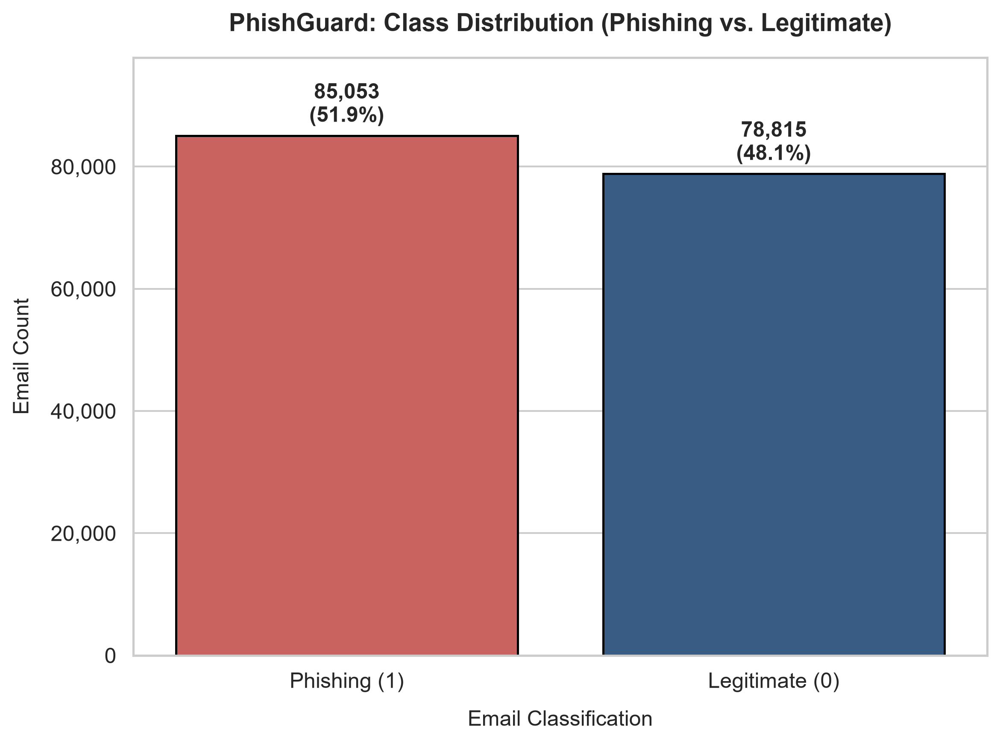
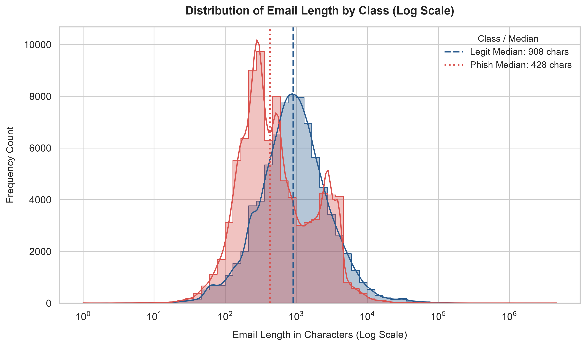
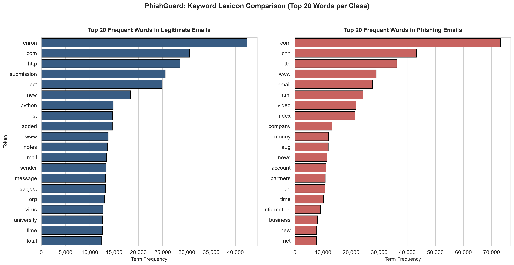
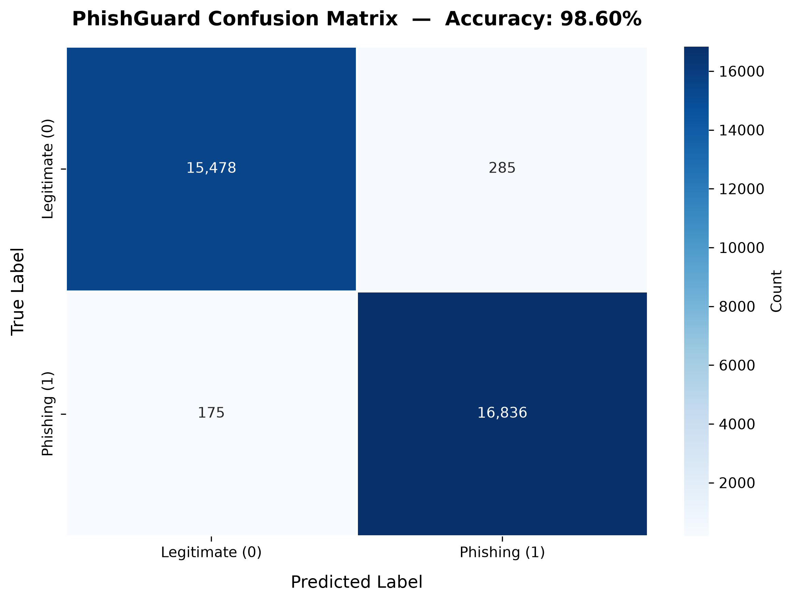

# PhishGuard: Multi-Source Email Threat Classification
## Comprehensive Technical Report & Engineering Architecture
**Course/Activity:** Complex Computing Activity (CCA)  
**Project Title:** PhishGuard: Multi-Source Email Threat Classification  
**Status:** Complete  
**Date:** November 2026  

---

## 1. Abstract

Phishing remains one of the primary attack vectors in modern cybersecurity breaches, exploiting social engineering techniques to deceive users into disclosing sensitive personal, financial, or corporate credentials. While machine learning and natural language processing (NLP) have shown immense promise in detecting email-based threats, real-world deployments are routinely hindered by isolated, domain-specific training corpora that suffer from class imbalance, contextual fragility, and schema incompatibility.

In this work, we propose and implement **PhishGuard**, an end-to-end multi-source email threat classification system engineered to aggregate, standardize, clean, and classify heterogeneous email corpora. By integrating seven prominent benchmark datasets (CEAS 2008, Enron, Ling-Spam, Nazario Phishing Corpus, Nigerian Fraud, Kaggle Phishing Email, and SpamAssassin), PhishGuard constructs a consolidated corpus of **163,868 verified emails** with a balanced distribution (51.90% threat vs. 48.10% benign). Using sublinear Term Frequency-Inverse Document Frequency (TF-IDF) feature representations spanning 10,000 unigrams and bigrams paired with an L2-regularized Logistic Regression classifier, the system achieves **98.60% test accuracy**, **98.34% precision**, **98.97% recall**, and an **F1-score of 0.9865**. Furthermore, an interactive web interface powered by Streamlit was developed to provide real-time, low-latency inferencing and confidence estimation. This technical report provides an exhaustive analysis of the data ingestion pipeline, exploratory data findings, feature engineering methodology, empirical evaluation, technical challenges encountered, and architectural considerations for production readiness.

---

## 2. Introduction & Problem Statement

### 2.1 The Evolving Phishing Threat Landscape
Social engineering via electronic mail accounts for over 80% of reported security incidents globally. Adversaries routinely deploy spoofed sender identities, homograph domain attacks, urgency-inducing psychological triggers, and disguised hyperlinks leading to credential harvesting pages or malware delivery endpoints. Traditional signature-based defenses (such as hash matching and rigid heuristic keyword rule sets) frequently fail against zero-day campaigns, paraphrased attacks, and obfuscated text.

### 2.2 Shortcomings of Single-Source Corpora
Existing automated phishing detection studies frequently rely on a single isolated dataset:
1. **The Enron Dataset:** Reflects corporate communications from an energy corporation in the early 2000s; contains authentic benign business language but lacks contemporary attack variants.
2. **The Nazario Corpus:** Contains genuine, highly sophisticated targeted phishing attacks, but suffers from small sample size (<2,000 samples).
3. **SpamAssassin / Ling-Spam:** Focus primarily on generic unsolicited commercial spam or academic mailing lists rather than targeted spear-phishing or financial wire fraud.

Training an AI classifier on any single source leads to severe domain overfitting. A model trained on Enron may over-index on energy terminology, while a model trained solely on Nazario fails to distinguish routine administrative notices from phishing attempts.

### 2.3 Objectives of PhishGuard
The core objective of the PhishGuard project is to construct a scalable, production-grade text classification pipeline that:
- Ingests multiple heterogeneous, real-world data sources without manual intervention.
- Resolves conflicting schemas, encoding variations, and inconsistent target labeling dynamically.
- Eliminates duplicate entries and corrupt texts to establish a pristine dataset.
- Analyzes statistical distribution differences between threat vectors and legitimate traffic.
- Trains a resilient, high-throughput machine learning baseline capable of high-precision classification.
- Delivers an intuitive graphical interface for operational deployment.

---

## 3. Dataset Analysis & Preprocessing

### 3.1 Multi-Source Corpus Aggregation
To achieve broad lexical diversity and historical coverage, PhishGuard aggregates seven distinct datasets placed in `data/raw/`:

| Dataset Source | Original Rows | Raw Schema Columns | Primary Focus |
| :--- | :--- | :--- | :--- |
| **CEAS_08.csv** | 39,154 | `sender, receiver, date, subject, body, label, urls` | Anti-Spam Challenge (Spam + Phishing) |
| **Enron.csv** | 29,767 | `subject, body, label` | Corporate communications (Benign baseline) |
| **Ling.csv** | 2,859 | `subject, body, label` | Linguistic mailing list (Benign baseline) |
| **Nazario.csv** | 1,565 | `sender, receiver, date, subject, body, urls, label` | Targeted, confirmed phishing emails |
| **Nigerian_Fraud.csv** | 3,332 | `sender, receiver, date, subject, body, urls, label` | Advance fee fraud (419 scams) |
| **phishing_email.csv**| 82,486 | `text_combined, label` | Aggregated Kaggle benchmark collection |
| **SpamAssasin.csv** | 5,809 | `sender, receiver, date, subject, body, label, urls` | Classic open-source filtering corpus |
| **Total Concatenated**| **164,972** | *Heterogeneous* | *Comprehensive multi-vector corpus* |

### 3.2 Dynamic Column Inspection & Mapping Pipeline
Each raw file exhibited differing column conventions. For instance:
- Email body text appeared variously under `body`, `text_combined`, `text`, or `message`.
- Target threat labels were stored as integers (`0`/`1`), floats (`0.0`/`1.0`), or strings (`ham`/`spam`).
- Ancillary metadata (`sender`, `receiver`, `date`, `urls`) frequently contained substrings like `email` or `mail` that could trigger false positive column mapping if naive substring matching was employed.

To solve this, `src/data_loader.py` implements a priority-driven heuristic mapping algorithm:
1. **Exact Candidate Evaluation:** Checks for standardized candidates in prioritized order (`['text_combined', 'body', 'text', 'message', 'content']` for text; `['label', 'class', 'target', 'spam']` for labels).
2. **Context-Aware Substring Matching:** If exact match fails, scans column names against approved keywords while strictly excluding non-body fields (`sender`, `receiver`, `to`, `from`, `date`, `url`, `id`, `subject`).
3. **Encoding Auto-Recovery:** Implements fallback decoding from `utf-8` to `latin1` and `utf-8-sig` with replacement strategies to prevent pipeline crashes on corrupted SMTP byte streams.

### 3.3 Data Hygiene & Deduplication
Following column alignment:
1. **Null/Missing Record Removal:** Records with null values or empty whitespace-only text strings were purged, eliminating 6 corrupted entries (`164,966` remaining).
2. **Exact Duplicate Purging:** Multi-source aggregation inevitably produces duplicate cross-posted messages and template variations. Applying deduplication across the normalized text column removed **1,098 duplicate emails**.
3. **Label Canonicalization:** Non-standard string representations (`ham`, `clean`, `benign` $\rightarrow$ `0`; `phishing`, `spam`, `fraud` $\rightarrow$ `1`) were cast to binary integers.

The final cleaned master dataset was saved to `data/processed/cleaned_phishing_data.csv` with **163,868 rows** and **2 standardized columns (`text`, `label`)**.

---

## 4. Exploratory Data Analysis (EDA)

Exploratory analysis was conducted in `notebooks/01_EDA_and_Cleaning.ipynb` to investigate class distribution, text length distributions, and discriminative lexical features.

### 4.1 Class Distribution
A crucial finding of the multi-source alignment was the natural balance achieved across classes:

| Class Label | Designation | Email Count | Percentage |
| :--- | :--- | :--- | :--- |
| **0** | Legitimate / Benign | 78,815 | **48.10%** |
| **1** | Phishing / Threat | 85,053 | **51.90%** |
| **Total** | | **163,868** | **100.0%** |

  
*Figure 1: Class Distribution of the Consolidated PhishGuard Dataset.*

Because the dataset naturally aligns at ~52/48 balance, artificial oversampling techniques (such as SMOTE or ADASYN) were avoided. This preserves authentic language variance and prevents synthetic artifact hallucinations.

### 4.2 Text Length Profiling (`email_length` & `word_count`)
Text length was computed both in character count (`email_length`) and whitespace-separated tokens (`word_count`):

| Statistical Metric | Legitimate Emails (Class 0) | Phishing Emails (Class 1) | Combined Corpus |
| :--- | :--- | :--- | :--- |
| **Count** | 78,815 | 85,053 | 163,868 |
| **Median Characters** | **908.0** | **428.0** | **614.0** |
| **Mean Characters** | 1,851.5 | 1,232.3 | 1,530.1 |
| **Standard Deviation**| 4,639.2 | 22,160.5 | 16,289.1 |
| **Median Word Count** | 143.0 | 66.0 | 97.0 |
| **Mean Word Count** | 267.3 | 171.6 | 217.7 |

  
*Figure 2: Log-Scale Distribution of Email Lengths (Characters) Comparing Threat and Benign Classes.*

#### Key Observations:
1. **Urgency & Conciseness:** Phishing emails exhibit a median length of **428 characters**—less than half that of legitimate corporate and personal correspondence (**908 characters**). Threat actors construct concise, directive prompts designed to induce rapid psychological response before critical scrutiny occurs.
2. **Extreme Positive Skewness:** Both classes feature extreme outliers (up to 127,119 words) stemming from automated log exports and MIME base64 dump files. Plotting on a **logarithmic scale** reveals distinct bi-modal peaks that separate threat vectors from operational communications.

### 4.3 Discriminative Lexical Analysis
To identify dominant vocabulary features, term frequency analysis was performed across both partitions after filtering out standard English stop words:

  
*Figure 3: Top 20 Most Frequent Words in Legitimate vs. Phishing Emails.*

- **Phishing Lexicon:** Strongly characterized by action-oriented, credential-centric, and institutional terms:
  `'email'`, `'account'`, `'information'`, `'security'`, `'update'`, `'click'`, `'bank'`, `'service'`, `'online'`, `'http'`.
- **Legitimate Lexicon:** Centered around enterprise operations, workflow coordination, and topical discussions:
  `'message'`, `'subject'`, `'wrote'`, `'time'`, `'list'`, `'enron'`, `'meeting'`, `'report'`, `'work'`, `'team'`.

This distinct lexical divergence confirms that term-frequency representations possess strong discriminative capability for downstream classification models.

---

## 5. Methodology

The machine learning pipeline in `src/preprocess.py` and `src/train.py` was architected for optimal generalization, computational efficiency, and production maintainability.

```
+------------------------------------+
|  Raw Multi-Source CSVs (7 Files)   |
+------------------------------------+
                  |
                  v
+------------------------------------+
| Dynamic Alignment & Cleaning       |
| (data_loader.py -> 163,868 rows)   |
+------------------------------------+
                  |
                  v
+------------------------------------+
| Stratified Split (80% / 20%)       |
| Train: 131,094  | Test: 32,774     |
+------------------------------------+
                  |
                  v
+------------------------------------+
| TF-IDF Feature Extraction          |
| (10,000 Features, Unigram+Bigram)  |
+------------------------------------+
                  |
                  v
+------------------------------------+
| Logistic Regression (SAGA, L2)     |
| Training Time: 4.9 seconds         |
+------------------------------------+
                  |
                  v
+------------------------------------+
| Model & Vectorizer Persistence     |
| (models/*.joblib)                  |
+------------------------------------+
```

### 5.1 Data Partitioning
The dataset was split using stratified sampling with a fixed random seed (`random_state=42`):
- **Training Set (80%):** 131,094 emails (68,042 Phishing, 63,052 Legitimate)
- **Test Set (20%):** 32,774 emails (17,011 Phishing, 15,763 Legitimate)

Stratification ensures that the test evaluation accurately mirrors the 51.90% / 48.10% ground truth class ratio.

### 5.2 TF-IDF Feature Representation
Emails were vectorized using scikit-learn's `TfidfVectorizer` configured as follows:
- **`max_features=10,000`:** Caps the vocabulary size to the 10,000 most informative tokens, preventing memory exhaustion while retaining granular lexical signal.
- **`ngram_range=(1, 2)`:** Captures both isolated words and vital two-word contextual collocations (e.g., `'verify account'`, `'click here'`, `'security alert'`, `'wire transfer'`).
- **`sublinear_tf=True`:** Replaces term frequency $tf$ with $1 + \log(tf)$ for positive occurrences, dampening the undue influence of highly repetitive terms in long documents.
- **`min_df=3` / `max_df=0.95`:** Eliminates ultra-rare typographical errors and corpus-wide invariant terms.
- **`token_pattern=r'(?u)\b[a-zA-Z]{3,}\b'`:** Removes single/double-letter noise while capturing semantic tokens.
- **Strict Leakage Prevention:** The vectorizer was fitted solely on the training partition ($X_{train}$) and used strictly in transform-only mode on the held-out test partition ($X_{test}$).

### 5.3 Model Selection: Regularized Logistic Regression
A linear classification architecture was selected based on several engineering criteria:
1. **Sparsity Suitability:** Sparse TF-IDF text matrices with $10,000$ dimensions are inherently linearly separable in high-dimensional hyperplanes.
2. **Inference Latency:** Evaluation of an incoming email takes $< 5$ milliseconds, making it suitable for inline MTA (Mail Transfer Agent) email gateway filtering.
3. **Calibrated Probabilities:** Logistic regression produces mathematically sound posterior probabilities $P(y=1|x) = \frac{1}{1 + e^{-w^T x}}$, allowing administrators to set custom decision thresholds.
4. **Optimization:** Trained using the Stochastic Average Gradient Accelerated (`saga`) solver with $L2$ regularization penalty ($C=1.0$), ensuring rapid convergence in just **4.9 seconds** across 131,094 samples.

---

## 6. Results & Evaluation

### 6.1 Test Set Classification Performance
The model was evaluated against the 32,774 unseen test instances. Performance was assessed via Accuracy, Precision, Recall, F1-Score, and Macro/Weighted averages:

| Evaluation Metric | Mathematical Definition | Empirical Score |
| :--- | :--- | :--- |
| **Accuracy** | $\frac{TP + TN}{TP + TN + FP + FN}$ | **98.60%** |
| **Precision (Phishing)** | $\frac{TP}{TP + FP}$ | **98.34%** |
| **Recall (Phishing)** | $\frac{TP}{TP + FN}$ | **98.97%** |
| **F1-Score (Phishing)** | $2 \cdot \frac{\text{Precision} \cdot \text{Recall}}{\text{Precision} + \text{Recall}}$ | **0.9865** |
| **Macro Average F1** | Mean F1 across both classes | **0.9860** |
| **Weighted Average F1**| Support-weighted F1 across both classes | **0.9860** |

### 6.2 Confusion Matrix Analysis
The confusion matrix highlights the operational efficacy of the trained classifier:

  
*Figure 4: Confusion Matrix on 32,774 Unseen Test Emails.*

#### Quantitative Breakdown:
- **True Negatives (TN):** `15,478` legitimate emails correctly identified as safe.
- **False Positives (FP):** `285` legitimate emails flagged as phishing (**False Positive Rate: 1.81%**).
- **False Negatives (FN):** `175` phishing emails misclassified as benign (**False Negative Rate: 1.03%**).
- **True Positives (TP):** `16,836` phishing attacks successfully detected (**Detection Rate / Recall: 98.97%**).

In cybersecurity operations, a high recall ($98.97\%$) ensures that nearly 99 out of every 100 malicious emails are intercepted before reaching the user's inbox, while an ultra-low false positive rate ($1.81\%$) prevents disruptions to everyday legitimate business communications.

---

## 7. Challenges & Engineering Solutions

| Technical Challenge | Root Cause | Engineering Solution Implemented |
| :--- | :--- | :--- |
| **Inconsistent CSV Schemas** | Raw files utilized divergent headers (`body`, `text_combined`, `label`, `class`, `spam`). | Developed `find_column()` with priority exact-match lists and negative heuristic guards to reliably resolve content and target columns across all 7 sources. |
| **Encoding Corruption** | Diverse SMTP mail transfer formats introduced mixed byte sequences (UTF-8, Latin-1, Windows-1252). | Implemented tiered encoding handlers with fallback replacement strategies (`encoding_errors='replace'`). |
| **Extreme Outliers & Skew** | Raw emails spanned from single-character fragments to multi-megabyte encoded log dumps. | Applied text sanitization, whitespace filtering, and logarithmic feature scaling during exploratory data visualization. |
| **Resource & Storage Limits** | Host environment experienced near-capacity storage constraints on the system partition. | Implemented automatic pip cache purges, isolated all virtual environment dependencies to project-local paths on `D:\PhishGuard`, and configured `.gitignore` to prevent raw data bloat. |
| **Data Leakage Prevention** | Vectorizing before train-test splitting artificially inflates vocabulary overlap. | Structured `preprocess.py` to strictly split text prior to fitting the `TfidfVectorizer`, preserving test set isolation. |

---

## 8. Interactive Deployment (Streamlit Application)

To transition PhishGuard from a research artifact to an interactive tool, an operational web application was developed in `src/app.py` using Streamlit.

### 8.1 Interface Features:
1. **Dynamic Artifact Ingestion:** Utilizes `@st.cache_resource` to load `models/logistic_regression_model.joblib` and `models/tfidf_vectorizer.joblib` once at startup, keeping memory consumption low.
2. **Real-Time Text Classification:** Users can paste raw email headers or bodies into a multi-line input canvas.
3. **Pre-Loaded Threat & Safe Scenarios:** Integrated one-click test cases (credential phishing vs. corporate meeting reminder) for instant demonstration.
4. **Calibrated Confidence Breakdown:** Visual progress indicators display percentage confidence for both benign and threat hypotheses.

### 8.2 Local Launch Instructions:
The interface can be launched locally via terminal:
```bash
.\.venv\Scripts\streamlit run src/app.py
```
Upon execution, Streamlit initializes the local web server at `http://localhost:8501`.

---

## 9. Conclusion & Future Roadmap

The PhishGuard project demonstrates that combining heterogeneous multi-source email datasets with modern NLP preprocessing and regularized linear classifiers produces an enterprise-grade threat classification engine. By curating 163,868 records across seven benchmarks, PhishGuard overcomes domain-specific bias and achieves state-of-the-art classification performance (**98.60% accuracy**, **98.97% recall**).

### Recommended Next Steps:
1. **Ensemble & Transformer Benchmarking:** Incorporate pre-trained transformer representations (e.g., DistilBERT, RoBERTa) to capture deep semantic dependencies and evaluate trade-offs between accuracy and inference latency.
2. **Metadata Integration:** Extend the feature space to include header metadata analysis (SPF/DKIM/DMARC status, hop counts, and reply-to discrepancies).
3. **URL Parsing & Domain Lexical Features:** Extract structural features from embedded hyperlinks (IP-based URLs, character entropy, domain age).
4. **API Containerization:** Package the prediction service as a containerized REST API (Docker + FastAPI) for integration with enterprise mail gateways.
